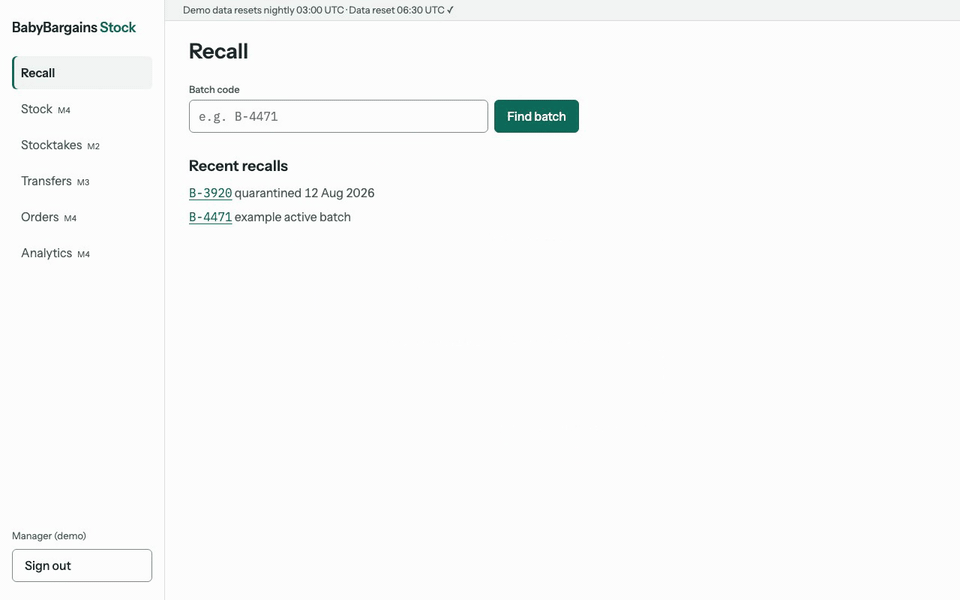

# BabyBargains Stock

Stock control for a fictional UK chain of baby-goods shops, built on MongoDB with an append-only stock ledger.

> **Recall finder.** Type a batch code and see every unit across every branch and size/colour variant:
> received, transferred, sold, on shelf. Drag the date slider to replay where the batch went, then
> quarantine it everywhere with one typed confirmation and get a pull list for store teams.



**Live demo:** [babybargains-stock.vercel.app](https://babybargains-stock.vercel.app) (choose Manager) · Fictional chain, synthetic data, resets nightly.

## Why a ledger, not a counter

Most stock tutorials store `onHand` as a number and decrement it. That answers "how many?" but not
"which ones, where, and since when?", which is exactly what a product recall asks.

Here every change is a movement in `stockMovements` (`RECEIVED`, `SOLD`, `TRANSFER_OUT/IN`,
`ADJUSTMENT`, `RECALLED`), tagged with branch, SKU and supplier batch. `inventory` is a projection of
that ledger, updated in the same transaction.

```
command ─► commandLog insert (duplicate commandId: same body → return the first result, different → 409 COMMAND_ID_REUSED)
        ─► FIFO allocation (pure function, shared by seed, server and browser)
        ─► postMovements, one transaction:
              negative qty: inventory.updateOne({.., onHand ≥ n}, {$inc: -n}); no match → abort
              positive qty: inventory upsert {$inc: +n}
              insert stockMovements
```

**Honest numbers.** Tills don't record batch numbers, so a sale's batch is *inferred* oldest-first
(FIFO). The UI says so: estimated figures have a dotted underline and a plain-English tooltip; only
recorded or counted figures are solid.

## What's in Milestone 1

- Polymorphic catalogue (cots, prams, monitors, clothing variants, toys) in one `products`
  collection; Zod schemas are the source of truth and MongoDB `$jsonSchema` validators are generated
  from them, with a drift test.
- Ledger write path: sales (multi-line, all-or-nothing), transfers, quarantine, deliveries. Every
  command is idempotent by `commandId`.
- Recall screen: number strip, day-by-day slider with event ticks and Play, branch table,
  typed-confirm quarantine with a printable pull list. Desktop, tablet and phone layouts.
- Deterministic seed: 15 branches, 300 SKUs, 12 months, ~250k movements, ~125 MB.
- Nightly server-side reset that removes visitor changes and shifts dates to end today, so the
  free Atlas tier never re-uploads the dataset.
- Demo safety: signed session cookie, server-side role checks, per-session rate limits
  (quarantine 1/hour), structured JSON logs per command, `/api/health`.

## What's in Milestone 2: stocktake

- **Clerk (phone):** pick a branch at sign-in, start or resume the branch stocktake, scan (camera
  where the browser supports `BarcodeDetector`) or search, count with a big stepper, and save. The
  count is blind: no screen shows system quantities. Batch-tracked products (cots, prams, monitors)
  need a batch; the last one used is remembered. Counting the same product twice asks *add* (second
  location) or *replace* (recount). A "Not counted yet" tab and an "N of M products counted" footer
  show coverage; submitting with gaps asks whether to count them as zero or leave them out.
- **Manager:** a Stocktakes list with an awaiting-review badge, and a review screen that sorts lines
  by value at risk. Lines off by 3+ units or £50+ need an explicit Accept before approval.
- **Maths that survives a busy shop:** expected stock is evaluated at the moment each line was
  counted (current stock minus movements since), so sales during the count are not variances.
  Approval posts `ADJUSTMENT` movements: shortages come out oldest batch first, surplus goes to the
  newest active batch, or a per-SKU `UNBATCHED` batch if none is active. The review and the approval
  share one pure planning function, so what is reviewed is exactly what is posted.
- Count lines are append-only and idempotent by line id; one open stocktake per branch is enforced
  by a partial unique index. Recall figures turn solid ("counted") only when an approved batch-level
  count exists with no trading since.

## What's in Milestone 3: transfer suggestions

- **Manager (desktop/tablet):** a Transfers screen listing moves from branches holding too much of a
  SKU to branches below its reorder point, ranked by units that no longer need reordering, then
  retail value. Filter by receiving branch; Review opens a side panel with before/after stock and the
  batches that would move (oldest first); Accept moves the stock at once as a `TRANSFER_OUT/IN` pair.
- **The rule, per SKU and branch** (policy from `stockPolicies`: reorder point `rp`, overstock weeks
  `W`; velocity `v` = units sold in the last 8 weeks ÷ 8, counted in whole UTC days so a suggestion holds
  all day):
  - *donor:* weeks of cover (`onHand ÷ v`, infinite with no sales) above `W`; it keeps
    `max(⌈W·v⌉, rp+1)` and offers the rest.
  - *recipient:* `onHand < rp`; it is refilled to `max(rp+1, ⌈W/2·v⌉)`.
  - Lowest-cover recipients are served first, each from the donor with the most surplus left. A
    branch with an open stocktake is left out on both sides, unless it has been idle for 2 hours (the
    same rule that lets another clerk take it over).
- **Accept re-checks.** The suggestion is recomputed from the ledger inside the transaction: asking
  for more than it now allows returns 409 `SUGGESTION_STALE` with the current quantity, an open
  stocktake at either branch returns 409 `STOCKTAKE_OPEN`, and a resent `commandId` replays the first
  result. The screen and the command share one pure function (`src/domain/ledger/transfers.ts`).
- **Known limit:** velocity counts recorded sales, so a branch that sold out loses sales it could not
  record and looks slower than it is (see TODOS.md).
- The seed adds a deterministic scenario (separate random stream): 18 SKUs (or 5% of the catalogue if that is more)
  over-ordered at one branch with slow sales, and short at another after a demand spike and a missed
  delivery, so the demo always has suggestions.

Orders/imports and analytics are Milestone 4.

## Counting in a stockroom dead spot

Flip **Stockroom dead spot** in the demo strip on the count screen, count a few products, reload, then flip
it off and watch the counts send one by one.

- **Every save goes through one queue** (`src/components/count/countQueue.ts`): one localStorage key per
  line, sent oldest first, one request in flight. Counts survive reload and tab close; resends are
  idempotent by line id.
- **Count time is capture time.** The phone sends when the count was entered plus a send-time header; the
  server corrects clock skew, clamps to [stocktake open, now] and never stamps a line before an earlier one
  for the same item. A count queued before a sale gets no false variance.
- **Back-dating is visible.** The server stores arrival time; a line that arrived over 15 minutes after its
  count is flagged and needs an explicit accept on review.
- **Re-login resumes at once** with a rotating per-stocktake resume key (HMAC of a nonce, so the database
  never holds a usable key), still under the clerk's role and branch.
- Submit stays disabled, with the reason shown, until every queued count is sent or dealt with.

## Correctness checks

| Check | Where |
|---|---|
| Running balance per branch/SKU/batch never negative; transfers net to zero; nothing touches a batch after its recall; sale allocations match SOLD movements | `checkLedgerInvariants` after every seed and reset, and in tests |
| Live projection equals a fresh fold of the ledger | `projectionDiff` in tests and `npm run verify` |
| Random command sequences keep every invariant | fast-check property test (found a real bug: deliveries into a recalled batch) |
| Concurrent sales of the last unit never oversell | integration test, six concurrent sales |
| Counts interleaved with trading, then approval, keep the ledger exact | fast-check stocktake property test |
| Suggestions never exceed a donor's surplus or a recipient's need, and move min(Σsurplus, Σneed) | fast-check property test on the pure core |
| Accepts amid trading and stocktakes keep the ledger exact; over-asks are refused | fast-check ledger property test; E2E checks `projectionDiff` after its accepts |
| Sale vs quarantine in both completion orders | interleaving test |
| Applied validators equal the ones generated from Zod | `test/schemas.test.ts` |

## Run it locally

Requires Node 24. No MongoDB install needed: the dev script runs a real single-node replica set.

```bash
npm install
npm run db:local          # leave running; prints MONGODB_URI
cp .env.example .env.local  # paste the URI, set SESSION_SECRET
npm run seed              # ~10 s, prints sizes and invariant results
npm run dev               # http://localhost:3000 → Manager (batch B-4471) or Clerk (count stock)
```

| Command | What it does |
|---|---|
| `npm test` | Unit, integration and property tests (in-memory replica set) |
| `npm run test:e2e` | Playwright against a seeded in-memory database |
| `npm run verify -- --batch B-4471` | Invariants, projection diff and a batch's totals |
| `npm run reset` | The nightly reset, on demand |
| `npm run seed -- --profile preview` | Small dataset (3 branches, 60 SKUs) for preview deploys |
| `npm run demo:gif` | Re-records `docs/recall-demo.gif` against a local server on port 3300 |

## Deploying

1. Create a free MongoDB Atlas cluster with two databases: `bb_demo` (production) and `bb_preview`
   (Vercel previews). Seed both: `MONGODB_DB=bb_demo npm run seed` and
   `MONGODB_DB=bb_preview npm run seed -- --profile preview`.
2. Import the repo into Vercel and set `MONGODB_URI`, `SESSION_SECRET` and `MONGODB_DB` per environment.
   The `vercel-build` script applies the generated validators (moderate level) before `next build`,
   so a failed migration means the deployment is never promoted.
3. Add `MONGODB_URI` as a GitHub Actions secret and set the repo variable `DEMO_DB_READY=true` for the
   nightly reset. A smoke check hits `/api/health` after every successful Vercel deployment.

## Stack

Next.js 16 (App Router) · TypeScript · MongoDB 8 driver · Zod 4 · Vitest + mongodb-memory-server +
fast-check · Playwright. Design tokens and components are documented in [DESIGN.md](DESIGN.md).
